# Algorithms, trade-offs and results

What each stage does, which alternatives are implemented, how they compare, and
why each default was chosen. Single-frame figures show frame 100 of
`data/sequence_02`; sequence figures cover all 154 frames. Every figure can be
regenerated (see [Reproducing the figures](#reproducing-the-figures)).
Timings are from one core of a 2.1 GHz Xeon in a shared cloud VM, where repeated
runs differ by 10–20 %.

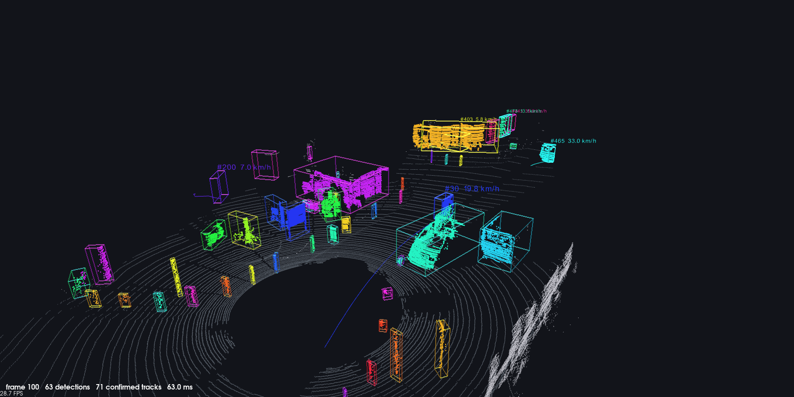

## Contents

1. [Pipeline](#pipeline)
2. [Scan layout and region of interest](#scan-layout-and-region-of-interest)
3. [Ground segmentation](#ground-segmentation)
4. [Clustering](#clustering)
5. [Bounding boxes](#bounding-boxes)
6. [Ego-motion](#ego-motion)
7. [Tracking](#tracking)
8. [Runtime](#runtime)
9. [Validation](#validation)
10. [Limitations](#limitations)
11. [Reproducing the figures](#reproducing-the-figures)
12. [References](#references)

## Pipeline

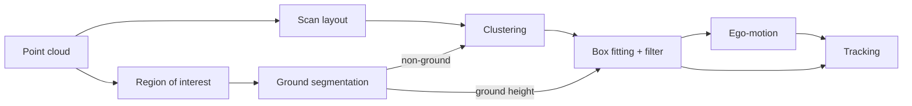

Every stage is an interface; the implementation is chosen by name in
`config/default.yaml`. Stages pass indices into the input cloud rather than
copies, so each result can be traced to its original return and to the point's
position in the scan order.

| Stage | Default | Alternatives |
|---|---|---|
| Ground segmentation | `region` | `ransac`, `ray`, `grid` |
| Clustering | `range_image` | `euclidean` |
| Box fitting | `lshape` (variance criterion) | `lshape` (area, closeness), `pca`, `aabb` |
| Ego-motion | `ndt` | `gicp`, `icp`, `none` |
| Tracking | constant-velocity Kalman filter, cascade matching | none |

## Scan layout and region of interest

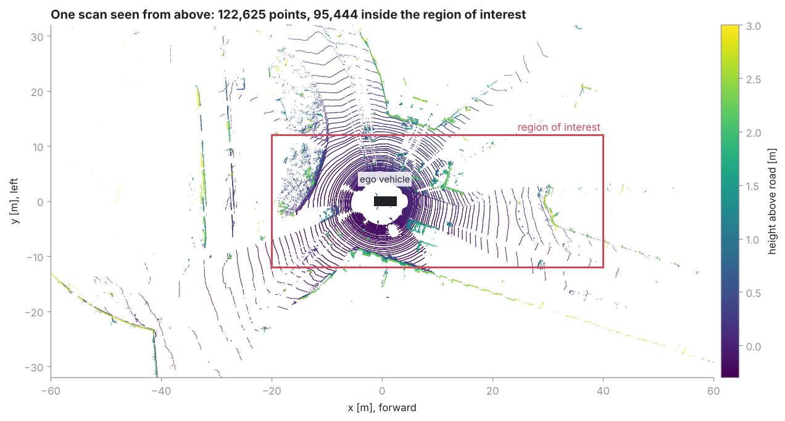

**Region of interest.** Points outside x ∈ [−20, 40] m, y ∈ [−12, 12] m and
z ∈ [−2.5, 1] m (sensor frame), and returns from the ego vehicle itself, are
dropped. On frame 100 this keeps 95 444 of 122 625 points. No voxel grid is
applied at this point: the range image needs the original scan structure, and
the ground segmenters are fast enough on all points.

**Range-image layout.** Each point gets a row (laser) and a column (azimuth, 2048
bins). Many drivers, including the one that produced the sample data, store a
spinning scanner's points laser by laser, so the azimuth restarts with every new
laser; counting those restarts gives each point's laser index directly. On the
sample data the count matches the 64 lasers (a few trailing points that already
belong to the next sweep are assigned to the last laser). If the restarts do not add up to the
configured laser count (another driver, shuffled points), rows are binned by
elevation angle instead. Recovered rings are preferable because the lasers of
many sensors are not evenly spaced in elevation, so binning puts some
neighbouring lasers in the same row and leaves other rows empty.

## Ground segmentation

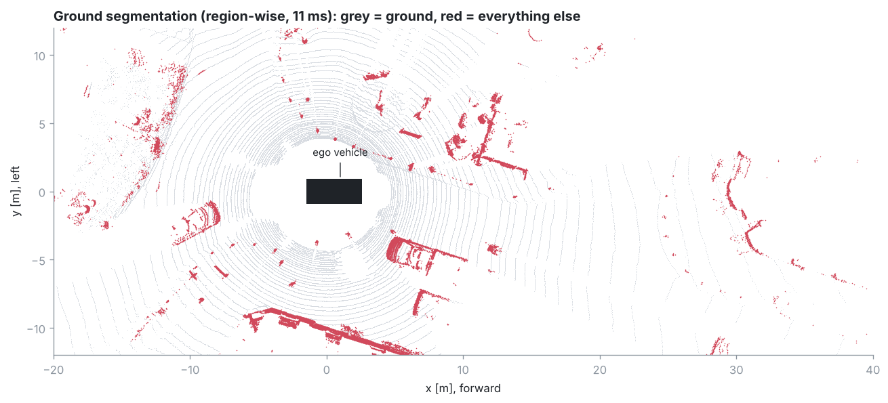

Four methods are implemented. To show where they differ, the figure below
compares each method with the majority vote of all four. Red points are called
obstacle by this method but ground by at least three of the others; blue points
are the reverse.

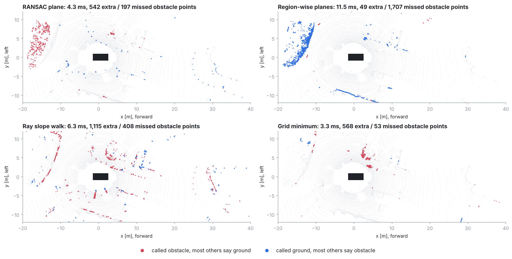

| Method | How it works | Frame 100 | Strengths | Weaknesses |
|---|---|---|---|---|
| RANSAC plane | One plane for the whole scene | 4.3 ms | Fast; robust on flat roads | One plane cannot follow slopes: the rising bank on the left becomes obstacle |
| Region-wise (default) | One plane per polar bin, then plausibility checks | 11.5 ms | Follows rising terrain; rejects car roofs and walls through the checks | Slowest; most parameters; also accepts a gently rising bank as ground |
| Ray slope walk | Walk outwards along each azimuth ray | 6.3 ms | Cheap; tolerates gentle slopes | Most disagreements: noisy rays and occlusion gaps mislead it |
| Grid minimum | Height above the lowest nearby point | 3.3 ms | Fastest; no model | Needs road visible nearby; no slope within a cell |

The two large disagreements on frame 100 are both on the left side of the road:

* A **bank** about 13–17 m away rising 0.1–0.6 m above the road (1 301 points).
  Region-wise follows the slope and calls it ground; the methods that test
  height against a single road level call it obstacle. Which is right depends on
  whether the bank counts as drivable surface.
* The **base of a wall** at y ≈ −10 m (269 points, 1–6 cm above the road), which
  region-wise calls ground and the others call obstacle.

**Choice.** Region-wise is the default because it is the only method that adapts
to local terrain and also checks whether a surface is plausible as road. Its
11 ms fits the 100 ms frame budget. RANSAC is the better choice on flat roads
when speed matters most.

### RANSAC plane

Classic RANSAC [[Fischler & Bolles 1981](#ref-ransac)] with five additions:

* Hypotheses are drawn only from points less than 0.6 m above the expected road,
  so walls and roofs are never proposed.
* Planes tilted more than 15° are rejected at once.
* The iteration count adapts:
  $N = \lceil \log(1-p) / \log(1-w^3) \rceil$, with $w$ the best inlier ratio so
  far and $p = 0.999$. On frame 100 it stopped after 22 of at most 200
  iterations.
* The winning plane is refined by least squares on its inliers (the normal is
  the eigenvector of the smallest eigenvalue of the inliers' covariance).
* Points below the plane also count as ground, so returns under the road surface
  never become obstacles.

### Region-wise planes

After *Patchwork* [[Lim et al. 2021](#ref-patchwork)]. The area around the
sensor is divided by a **concentric zone model**: four zones (edges at 2.7, 12,
22, 40 and 80 m) with 2/4/4/4 rings and 16/32/54/32 sectors. Bins are small
near the sensor, where returns are dense, and larger further out, so every bin
gets enough points.

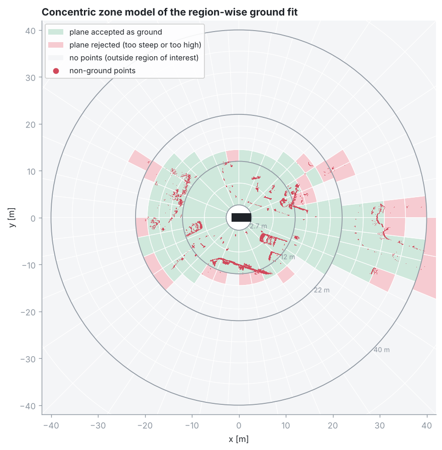

In each bin:

1. **Seeds.** The lowest 20 points are averaged; points within 0.4 m above that
   average become seeds. Two safeguards keep stray low returns from seeding a
   tilted plane:
   * Points more than 0.5 m below the expected road are treated as reflections:
     labelled ground, never used as seeds.
   * A plane needs at least 20 seeds. A smaller group of very low points is
     skipped.
2. **Plane.** Fit a plane to the seeds, take all points within 0.15 m of it
   (and all points below it) as the new ground set, and repeat three times.
3. **Plausibility.** The plane is rejected if it tilts more than 45°. Within
   22 m, a plane more than 0.7 m above the expected road is accepted only if it
   is very flat, which admits a raised pavement but not a car roof.
4. **Sparse bins** (fewer than 10 points) use a plain height test instead.

[*Patchwork++*](#ref-patchwork-pp) adds adaptive thresholds, temporal ground
revert and reflected-noise removal; those are not implemented here.

### Ray slope walk

After Autoware's ray ground filter [[Autoware](#ref-autoware)]. Points are
grouped into 0.4°-wide azimuth sectors and sorted by range. Walking outwards
from the sensor, a point is ground if two slopes are small: from the previous
ground point (at most 8°) and from the sensor's foot point (at most 5°). After a
gap longer than 2 m (usually an occlusion), only the second test is used.

### Grid minimum

For each 0.5 m cell, the reference height is the lowest point in the
surrounding 3 × 3 cells. Looking at neighbours means a cell completely covered
by a car roof still sees the road next to it. A point is ground if it is within
0.18 m of that reference and the reference itself is near road height.

## Clustering

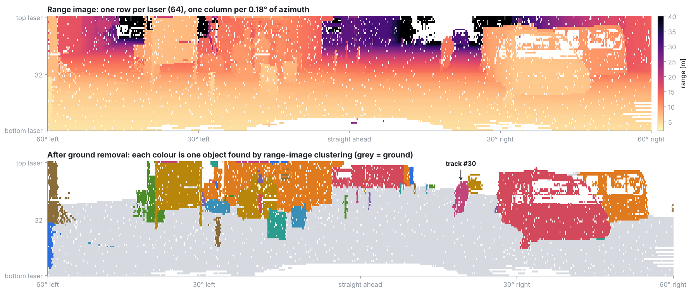

### Range-image clustering (default)

After Bogoslavskyi & Stachniss [[2016](#ref-depth-clustering)]. Non-ground points
are written into the 64 × 2048 range image; where two points fall in the same
pixel, the closer one is kept. Objects are then grown pixel by pixel. Two
neighbouring returns at ranges $d_1 \ge d_2$, whose beams are an angle $\alpha$
apart, are joined when

$$\beta = \operatorname{atan2}\big(d_2 \sin\alpha,\; d_1 - d_2\cos\alpha\big) > 10^\circ .$$

$\beta$ is the angle between the farther beam and the line joining the two
returns. Along a continuous surface it stays large; at the depth jump between
two objects, such as a pole in front of a wall, it drops towards zero.
$\alpha$ is computed from the two returns themselves, so uneven laser spacing
does not matter.

Four details:

* **Gaps.** The neighbour search skips up to 3 empty columns or 2 empty rows, so
  missing returns and removed ground pixels do not split objects.
* **Distance gate.** Neighbours more than 1.5 m apart are never joined.
* **Grazing surfaces.** A surface seen at a very flat angle, such as a long wall
  beside the road, has large depth steps between neighbouring pixels, and the
  $\beta$ test cuts it into pieces. Clusters that share a 0.4 m voxel are
  therefore merged afterwards with a union-find pass, which costs O(n).
* **Collisions.** Points hidden behind a closer return in the same pixel join
  that return's object if they are within the distance gate.

### Euclidean clustering

Region growing in 3D: neighbours within a radius belong to the same cluster.

* **k-d tree.** A static k-d tree built by median splits, which keeps the tree
  balanced (depth ⌈log₂ n⌉) for any point order.
* **Iterative growth.** Breadth-first search with an explicit queue, so very
  large clusters cannot overflow the call stack.
* **Range-adaptive radius.** $r = 0.45 + 0.012 \cdot \text{range}$ m, because the
  gap between neighbouring beams grows with distance.
* **Down-sampling.** Clustering runs on a 0.15 m voxel subset; every original
  point then takes the label of its nearest representative.

### Comparison

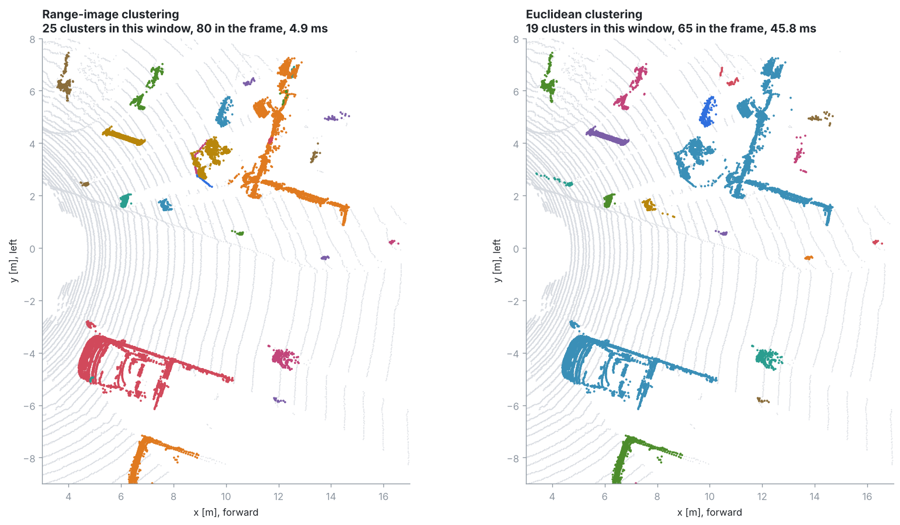

| | Range image | Euclidean |
|---|---|---|
| Frame 100 | 80 clusters, 4.9 ms | 65 clusters, 46 ms |
| Neighbourhood | Pixel neighbours in the scan | Any point within a radius |
| Objects close together at different depths | Separated by the depth jump | Merged (top right of the close-up: several objects become one cluster) |
| Surfaces seen at a grazing angle | Split, then rejoined by the merge pass | Kept whole |
| Needs | The scan structure (ring order or elevation binning) | Nothing beyond the points |

**Choice.** The range image is about ten times faster and separates neighbouring
objects that Euclidean clustering merges. Euclidean clustering is the fallback
for data without usable scan structure, such as merged or accumulated clouds.

## Bounding boxes

All boxes are gravity-aligned: they rotate only about the vertical axis, since
road users do not roll or pitch noticeably.

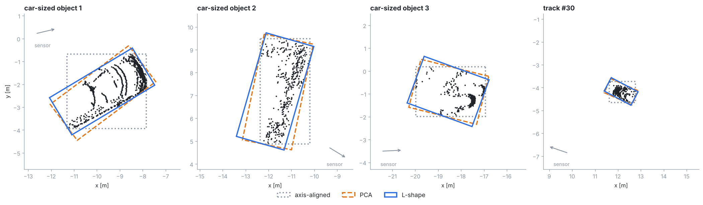

| Method | Heading from | Strengths | Weaknesses |
|---|---|---|---|
| Axis-aligned | Sensor axes | Trivial | Ignores orientation; a reference only |
| PCA | Principal axis of the footprint | Fast; accurate when the full outline is visible | Biased when only part of an object is seen: for an L-shaped view the principal axis lies between the two visible sides |
| L-shape (default) | Best-scoring rectangle over all headings | Designed for the partial views a LiDAR gets | 90 score evaluations per cluster |

### L-shape fitting

After Zhang et al. [[2017](#ref-lshape)]. For each candidate heading θ from 0° to
89° in 1° steps, the footprint points are projected onto the two rectangle axes
and the rectangle is scored. Three criteria are implemented:

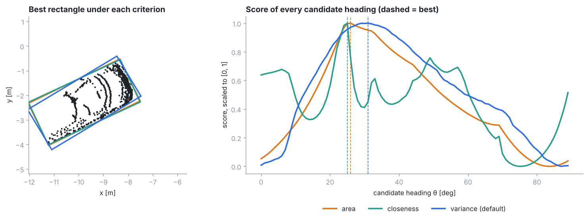

| Criterion | Score | Behaviour |
|---|---|---|
| Area | Smaller rectangle is better | Ambiguous for L-shapes: an L's hull is a right triangle, whose smallest enclosing rectangle is equally small aligned with either leg or with the hypotenuse |
| Closeness | Points near an edge are better | Sharp peak, but jagged with secondary peaks (green curve) |
| Variance (default) | Small spread of point-to-edge distances is better | Smooth curve with a single maximum |

On this car the three best headings are within 6° of each other. Variance is the
default because its score curve is smooth with one maximum, which makes the
result less sensitive to noise. That conclusion rests on inspected examples and
on the unit tests (heading within 2.5° on synthetic partial views), not on
labelled data.

For speed, clusters larger than 256 points are evenly sub-sampled for the
heading search only; the box extent always uses every point.

### Ground snap and detection filter

* **Ground snap.** The lowest returns of a car are often 0.2–0.4 m above the
  road (bumper height, occlusion). If the gap to the local ground height is
  below 0.4 m, the box is extended down to the ground. The local ground height
  comes from a 2 m grid of the frame's ground points.
* **Detection filter.** A cluster becomes a detection only if its box is
  0.3–4 m tall, at most 12 m long and 5 m wide, and starts less than 1 m above
  the ground. This removes building walls, tree canopies, signs and noise.
  Because it only looks at size, fence corners and pieces of buildings that fit
  these limits still pass (the large boxes right of centre below).

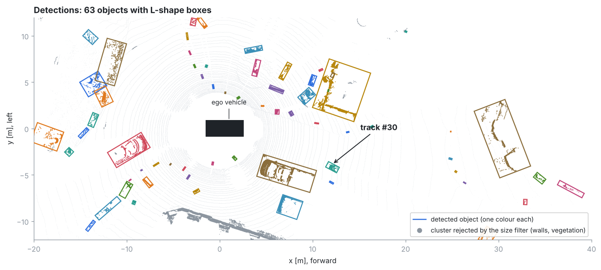

## Ego-motion

Tracking needs a fixed frame: otherwise a parked car appears to move at the ego
vehicle's speed. Each scan is registered to the previous one using only the
points that were **not** detected as objects, so moving objects do not distort
the estimate. Points beyond 50 m are dropped and the rest down-sampled to 0.5 m.
The previous motion serves as the initial guess. The chained registrations give
the sensor pose in a world frame fixed at the first scan.

| Method | How it matches scans | Distance travelled | Speed jitter between frames (std) | Static tracks under 1 m/s | Time |
|---|---|---|---|---|---|
| **NDT** [[Biber & Straßer 2003](#ref-ndt)] (default) | Points against per-cell Gaussians | 71.2 m | 0.09 m/s | 81 % | 44 ms |
| GICP [[Segal et al. 2009](#ref-gicp)] | Plane-to-plane, probabilistic | 71.5 m | 0.11 m/s | 81 % | 92 ms |
| ICP [[Besl & McKay 1992](#ref-icp)] | Point to nearest point | 67.2 m | 0.61 m/s | 71 % | 68 ms |

(Measured over the whole of `sequence_02` in one session. "Static tracks" are
confirmed tracks lasting at least 15 frames.)

NDT and GICP agree on the motion. Point-to-point ICP estimates about 6 % less
distance and is much noisier. A likely cause is that matching individual
nearest points on the ground locks onto the rings of the scan pattern, which
move with the car; this is a hypothesis, not something measured. **NDT is the
default:** it matches GICP's estimate at half the cost.

## Tracking

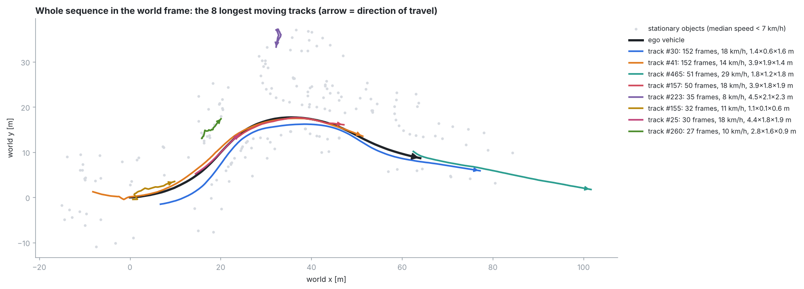

### Motion model

One **constant-velocity Kalman filter** per track, in the ground plane of the
world frame. The state is $x = [p_x, p_y, v_x, v_y]$; the measurement is the box
centre $z = [p_x, p_y]$:

$$F = \begin{bmatrix} I & \Delta t\, I \\ 0 & I \end{bmatrix},\qquad
Q = \sigma_a^2 \begin{bmatrix} \tfrac{\Delta t^4}{4} I & \tfrac{\Delta t^3}{2} I \\ \tfrac{\Delta t^3}{2} I & \Delta t^2 I \end{bmatrix},\qquad
H = [\,I\;\;0\,],\quad R = \sigma_z^2 I$$

* $Q$ models an unknown acceleration with standard deviation
  $\sigma_a = 2\ \text{m/s}^2$; the measurement noise is $\sigma_z = 0.25$ m
  [[Bar-Shalom et al. 2001](#ref-barshalom)].
* The covariance update uses the Joseph form, which keeps it symmetric and
  positive definite.
* $\Delta t$ comes from frame timestamps: an optional `timestamps.txt`,
  otherwise 0.1 s.
* Box size, height and heading are smoothed outside the filter. The heading
  update treats θ and θ + 180° as the same box.

### Data association

1. **Gating.** A detection can only match a track if its squared Mahalanobis
   distance $y^\top S^{-1} y$ is below 9.21 (99 % of the χ² distribution with 2
   degrees of freedom) and it is within 3 m.
2. **Cost.** The negative log-likelihood $y^\top S^{-1} y + \ln|S|$. The
   $\ln|S|$ term matters: with Mahalanobis distance alone, a new track's large
   uncertainty makes every nearby detection look close, so new tracks win
   detections from established ones.
3. **Matching cascade** (as in DeepSORT [[Wojke et al. 2017](#ref-deepsort)]).
   Confirmed tracks are matched first; tentative tracks only compete for the
   detections left over.
4. **Assignment.** Each stage is solved optimally with the Hungarian algorithm
   [[Kuhn 1955](#ref-kuhn); [Munkres 1957](#ref-munkres)]. The implementation
   accepts rectangular cost matrices and is tested against brute force.

### Track life cycle

A new track is *tentative*. It becomes *confirmed* after 3 hits. A tentative
track is deleted after 1 missed frame; a confirmed track coasts on its
prediction for up to 5 missed frames before deletion.

### Results on `sequence_02`

There are no labels, so object types below are inferred from size and speed.

| Track | Frames | Coasting frames | Median speed | Median size (L × W × H) | Likely object |
|---|---|---|---|---|---|
| #30 | 2–153 (all 152) | 0 | 17.5 km/h | 1.41 × 0.61 × 1.64 m | cyclist ahead of the ego vehicle |
| #41 | 2–153 (all 152) | 0 | 14.4 km/h | 3.88 × 1.90 × 1.38 m | car following the ego vehicle |

* **Ego-motion:** the estimated ego path is 71 m long at 4.7 m/s on average.
* **Static objects:** of the 202 confirmed tracks lasting at least 15 frames,
  163 (81 %) have a median speed below 1 m/s; these are parked cars, poles and
  walls.
* **Spurious motion:** some tracks have short, jagged paths at 8–11 km/h, for
  example #155, #223 and #260 in the figure above. These are almost certainly
  static clutter, such as vegetation, whose box centre jumps as its visible
  shape changes from scan to scan.

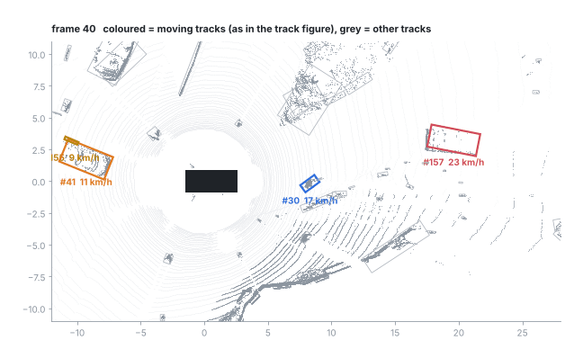

## Runtime

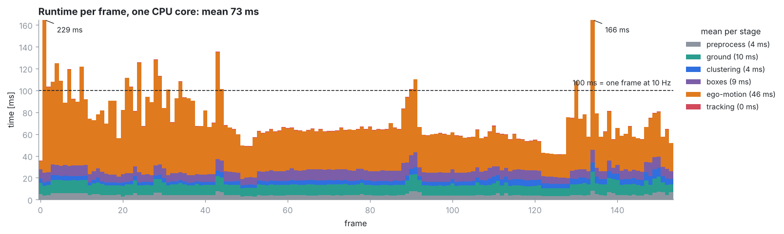

| Stage | Mean | 95th percentile |
|---|---|---|
| Preprocess (scan layout, region of interest) | 4 ms | 7 ms |
| Ground (region-wise) | 10 ms | 13 ms |
| Clustering (range image) | 4 ms | 6 ms |
| Boxes (L-shape) | 9 ms | 11 ms |
| Ego-motion (NDT) | 46 ms | 87 ms |
| Tracking | 0.3 ms | 0.5 ms |
| **Total** | **73 ms** | **115 ms** |

Measured with `OMP_NUM_THREADS=1` over all 154 frames.

* **Detection** (every stage except ego-motion) takes 27 ms on average and at
  most 46 ms.
* **Ego-motion** dominates. In this run 20 of 154 frames exceed the 100 ms of a
  10 Hz sensor, among them the first registration (229 ms), which has no motion
  prior.
* **Options** when the budget is tight: register every second frame, use a
  coarser NDT grid, or take odometry from the vehicle and set
  `ego_motion.method: none`.

## Validation

There is no labelled ground truth for the sample data, so validation has three
parts.

1. **Unit tests with known answers** (`tests/`, 30 tests, run in CI). A
   synthetic 64-laser scanner (`tests/synthetic.h`) ray-casts scenes of boxes on
   flat ground. The tests check:
   * ground and object recall for every ground method, including returns below
     the road surface;
   * cluster purity for both clusterers, separation at depth jumps, ring
     recovery and its fallback;
   * k-d tree search against brute force;
   * L-shape heading and size on partial views, the PCA bias, ground snapping;
   * the Hungarian solver against brute force;
   * Kalman filter convergence within its own 3σ bound;
   * two tracks keeping their identities through a crossing with a 2-frame
     occlusion;
   * configuration parsing.
2. **Consistency on real data.** Static objects should be (and mostly are)
   still in the world frame, the ego path should be smooth, and long-lived
   objects should keep one identity.
3. **Visual inspection** of every stage, using the figures in this document.

## Limitations

* **No quantitative benchmark.** With labelled data (for example KITTI
  Tracking), the CSV output of `lidar_od_run` can be scored for detection
  precision and recall by distance, and for tracking metrics such as MOTA or
  HOTA.
* **No classification.** Detections have no class. A classical classifier
  (random forest or SVM) over cluster features (size, point density relative to
  range, eigenvalue shape features, intensity, track speed), with a vote over
  each track's history, would be the next step. It would also suppress the
  spurious motion of vegetation.
* **Motion model.** Constant velocity suits 10 Hz city traffic. A
  constant-turn-rate model with an unscented Kalman filter, or an interacting
  multiple model, would follow turning vehicles more closely.
* **Partially seen objects.** The box covers only the visible part of an
  object, so its centre shifts as more of the object comes into view; the
  tracker absorbs this as velocity noise. Tracking the visible corner nearest
  the sensor is a common improvement.
* **Ground on slopes.** The ground methods have only been inspected on the
  gently sloped sample streets.

## Reproducing the figures

```bash
cmake -S . -B build && cmake --build build -j
./build/lidar_od_stages --frame 100 --out output/stages_100   # every method on one frame
OMP_NUM_THREADS=1 ./build/lidar_od_run --out output/run        # whole sequence
python3 scripts/render_figures.py --stages output/stages_100 --run output/run \
    --data data/sequence_02 --out docs/images
xvfb-run -a ./build/lidar_od_viewer --screenshot docs/images/00_viewer_3d.png --frame 100 --size 1600x800
```

## References

* <a id="ref-ransac"></a>M. A. Fischler, R. C. Bolles. *Random Sample Consensus: A Paradigm for Model Fitting with Applications to Image Analysis and Automated Cartography.* Communications of the ACM, 1981. [doi:10.1145/358669.358692](https://doi.org/10.1145/358669.358692)
* <a id="ref-patchwork"></a>H. Lim, M. Oh, H. Myung. *Patchwork: Concentric Zone-based Region-wise Ground Segmentation with Ground Likelihood Estimation Using a 3D LiDAR Sensor.* IEEE RA-L, 2021. [arXiv:2108.05560](https://arxiv.org/abs/2108.05560)
* <a id="ref-patchwork-pp"></a>S. Lee, H. Lim, H. Myung. *Patchwork++: Fast and Robust Ground Segmentation Solving Partial Under-Segmentation Using 3D Point Cloud.* IROS 2022. [arXiv:2207.11919](https://arxiv.org/abs/2207.11919)
* <a id="ref-autoware"></a>Autoware.Auto. *Ray ground classifier design.* [Documentation](https://autowareauto.readthedocs.io/en/release/ray-ground-classifier-design.html)
* <a id="ref-depth-clustering"></a>I. Bogoslavskyi, C. Stachniss. *Fast Range Image-Based Segmentation of Sparse 3D Laser Scans for Online Operation.* IROS 2016. [PDF](https://www.ipb.uni-bonn.de/wp-content/papercite-data/pdf/bogoslavskyi16iros.pdf)
* <a id="ref-lshape"></a>X. Zhang, W. Xu, C. Dong, J. M. Dolan. *Efficient L-Shape Fitting for Vehicle Detection Using Laser Scanners.* IEEE Intelligent Vehicles Symposium, 2017. [CMU RI](https://www.ri.cmu.edu/publications/efficient-l-shape-fitting-for-vehicle-detection-using-laser-scanners/)
* <a id="ref-ndt"></a>P. Biber, W. Straßer. *The Normal Distributions Transform: A New Approach to Laser Scan Matching.* IROS 2003. [doi:10.1109/IROS.2003.1249285](https://doi.org/10.1109/IROS.2003.1249285)
* <a id="ref-gicp"></a>A. Segal, D. Haehnel, S. Thrun. *Generalized-ICP.* Robotics: Science and Systems, 2009. [Proceedings](https://www.roboticsproceedings.org/rss05/p21.html)
* <a id="ref-icp"></a>P. J. Besl, N. D. McKay. *A Method for Registration of 3-D Shapes.* IEEE TPAMI, 1992. [doi:10.1109/34.121791](https://doi.org/10.1109/34.121791)
* <a id="ref-kuhn"></a>H. W. Kuhn. *The Hungarian Method for the Assignment Problem.* Naval Research Logistics Quarterly, 1955. [doi:10.1002/nav.3800020109](https://doi.org/10.1002/nav.3800020109)
* <a id="ref-munkres"></a>J. Munkres. *Algorithms for the Assignment and Transportation Problems.* Journal of SIAM, 1957. [doi:10.1137/0105003](https://doi.org/10.1137/0105003)
* <a id="ref-deepsort"></a>N. Wojke, A. Bewley, D. Paulus. *Simple Online and Realtime Tracking with a Deep Association Metric.* ICIP 2017. [arXiv:1703.07402](https://arxiv.org/abs/1703.07402)
* <a id="ref-barshalom"></a>Y. Bar-Shalom, X. R. Li, T. Kirubarajan. *Estimation with Applications to Tracking and Navigation.* Wiley, 2001.
* <a id="ref-kitti"></a>A. Geiger, P. Lenz, C. Stiller, R. Urtasun. *Vision meets Robotics: The KITTI Dataset.* IJRR, 2013. [doi:10.1177/0278364913491297](https://doi.org/10.1177/0278364913491297)
