# Algorithms, design decisions and results

This document explains every stage of the pipeline: what each algorithm does,
which alternatives were implemented or considered, why the default was chosen,
and how it behaves on real data. All figures are generated from
`data/sequence_02` (frame 100 for single-frame figures) by
`scripts/render_figures.py`, so they can be reproduced exactly (see the end of
this document).


*Frame 100 in the interactive viewer: L-shape boxes for every detected object,
moving objects labelled with track ID and speed, and the cyclist (#30) riding
ahead with its trail.*

## Contents

1. [Pipeline overview](#1-pipeline-overview)
2. [What changed and why](#2-what-changed-and-why)
3. [Scan layout and preprocessing](#3-scan-layout-and-preprocessing)
4. [Ground segmentation](#4-ground-segmentation)
5. [Clustering](#5-clustering)
6. [Bounding boxes](#6-bounding-boxes)
7. [Ego-motion](#7-ego-motion)
8. [Tracking](#8-tracking)
9. [Runtime](#9-runtime)
10. [Testing and validation](#10-testing-and-validation)
11. [Limitations and next steps](#11-limitations-and-next-steps)
12. [Reproducing the figures](#12-reproducing-the-figures)
13. [References](#13-references)

---

## 1. Pipeline overview

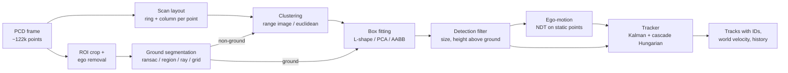

Every stage is an interface with interchangeable implementations chosen by
name in `config/default.yaml`. Stages pass **indices into the raw cloud**
instead of copying points. That keeps every result traceable to the original
return, and it preserves the scan order, which the range-image stage depends on.

| Stage | Default | Alternatives | Code |
|---|---|---|---|
| Ground | `region` | `ransac`, `ray`, `grid` | `src/ground/` |
| Clustering | `range_image` | `euclidean` | `src/cluster/` |
| Boxes | `lshape` (variance) | `lshape` (area, closeness), `pca`, `aabb` | `src/box/` |
| Ego-motion | `ndt` | `icp`, `gicp`, `none` | `src/tracking/ego_motion.cpp` |
| Tracking | CV Kalman + cascade Hungarian | – | `src/tracking/` |

## 2. What changed and why

| Area | Before | After | Why |
|---|---|---|---|
| Structure | Header-only templates, `.cpp` files `#include`d into apps, duplicate headers in `src/` and `include/`, committed `build/` | A `lidar_od` library with one interface per stage, two CLI apps, a viewer and a ROS 2 node; C++17; no build output in git | Builds cleanly, testable, each stage swappable |
| Ground | One global RANSAC plane, 25 fixed iterations, a set copied every iteration | Four segmenters. RANSAC gained adaptive stopping, a slope constraint, low-point sampling and least-squares refinement. Region-wise is the new default | A single plane fails on slopes and curbs; fixed iterations waste time or miss the plane |
| Clustering | Recursive Euclidean clustering on an unbalanced k-d tree, fixed radius | Range-image clustering (default), plus Euclidean clustering on a balanced tree with breadth-first search and a radius that grows with range | 10× faster; no stack overflow; adapts to sparse far returns |
| Boxes | 3-D PCA box, free to tilt | Gravity-aligned boxes: L-shape fitting, bottom snapped to the local ground, and a filter that rejects walls and vegetation | PCA heading is biased on partial (L-shaped) views |
| Tracking | Greedy nearest neighbour, 0.7/0.3 velocity smoothing, size-based labels; the Kalman tracker was a stub; one bug read past the end of an `Eigen::Vector3f` | Constant-velocity Kalman filter, χ² gating, negative-log-likelihood cost, matching cascade, Hungarian assignment, track life cycle | Globally optimal association, calibrated uncertainty, no identity switches on the sample data |
| Ego-motion | None (velocities relative to the moving car) | NDT odometry on non-object points; tracks live in a world frame | Parked cars now read about 0 km/h instead of the ego speed |
| Tooling | Visualizer loop only | YAML config with typo checking, headless runner (CSV and timing), stage dumper, figure script, 30 unit tests, CI, ROS 2 node | Reproducible and measurable |

The original single-class size heuristics ("bicycle", "pedestrian", ...) were
removed on purpose: without labelled data they could not be validated, and a
proper classifier is listed under [next steps](#11-limitations-and-next-steps).

## 3. Scan layout and preprocessing

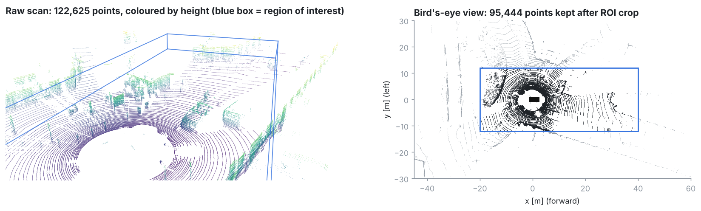

**Region of interest.** Points outside x ∈ [−20, 40] m, y ∈ [−12, 12] m,
z ∈ [−2.5, 1.0] m are dropped, along with returns from the ego vehicle's own
roof and body. On frame 100 this keeps 95 444 of 122 625 points.

**Ring recovery.** A rotating 64-beam scanner fires each laser around the full
circle. The sample files (KITTI raw) store points laser by laser, so the azimuth
restarts every time a new ring begins. `computeScanLayout` counts those
restarts to recover the **exact laser index** of every point, then bins the
azimuth into 2048 columns. If a cloud is not stored that way (unexpected ring
count, shuffled order, a driver that interleaves lasers), it falls back to
binning the elevation angle over the configured vertical field of view. A unit
test covers both paths.

Exact rings matter for the range image: binning by elevation angle mis-assigns
HDL-64E lasers, because their vertical spacing is not uniform (it changes
between the upper and lower laser blocks).

**No voxel grid before ground removal.** The old pipeline down-sampled to
0.3 m voxels first. That destroys the scan structure the range image needs and
blurs low obstacles. The new ground segmenters are fast enough to run on all
points; only the Euclidean clusterer down-samples (0.15 m), internally.

## 4. Ground segmentation

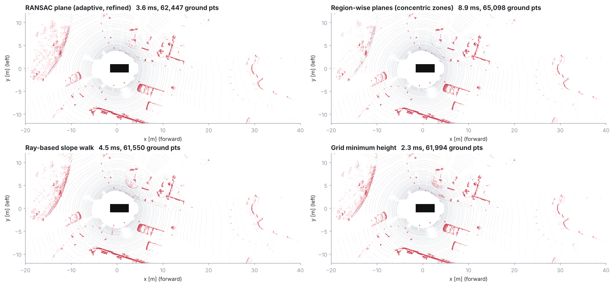

Grey points are ground and red points are obstacles. Timings are single-thread
on a 2.1 GHz Xeon.

| Method | Idea | Frame 100 | Strengths | Weaknesses |
|---|---|---|---|---|
| `ransac` | One plane, adaptive RANSAC + least squares | 3.6 ms, 22 iterations | Fast, simple, robust on flat roads | One plane cannot follow slopes, crowns or ramps |
| `region` (default) | A plane per polar bin, then plausibility checks | 8.9 ms | Follows slopes and uneven roads; rejects car hoods and roofs | More parameters; sparse far bins need a fallback |
| `ray` | Walk outwards along each azimuth, compare slopes | 4.5 ms | Handles gentle slopes, very cheap | Sensitive to occlusion gaps and single-ray noise |
| `grid` | Height above the lowest point of nearby cells | 2.3 ms | Fastest, no plane model | Needs a reference minimum; blind to slope inside a cell |

### 4.1 RANSAC (improved)

1. **Sampling only low points.** Hypotheses are drawn only from points less
   than 0.6 m above the expected road (sensor height 1.73 m). Walls and roofs
   are never proposed, so far fewer iterations are needed.
2. **Slope constraint.** Planes tilted more than 15° from horizontal are
   rejected immediately.
3. **Adaptive stopping.** After each improvement, the required number of
   iterations is updated to $N = \lceil \log(1-p) / \log(1-w^3) \rceil$, where
   $w$ is the best inlier ratio so far and $p = 0.999$. It stopped after 22
   iterations on frame 100; the cap is 200.
4. **Least-squares refinement.** Two total-least-squares refits on the inlier
   set (normal = smallest eigenvector of the covariance) remove the bias of
   the 3-point hypothesis.
5. **One-sided test.** Points *below* the plane are ground as well. Reflections
   under the road are never obstacles.

Inlier counting is parallelised with OpenMP, and no per-iteration set is
copied.

### 4.2 Region-wise ground fitting (default)

After *Patchwork* (Lim et al., 2021). The area around the sensor is split into
a **concentric zone model**: four zones (2.7–12–22–40–80 m) with 2/4/4/4 rings
and 16/32/54/32 sectors. Near the sensor the bins are small (dense returns);
far away they are large, so every bin holds enough points.

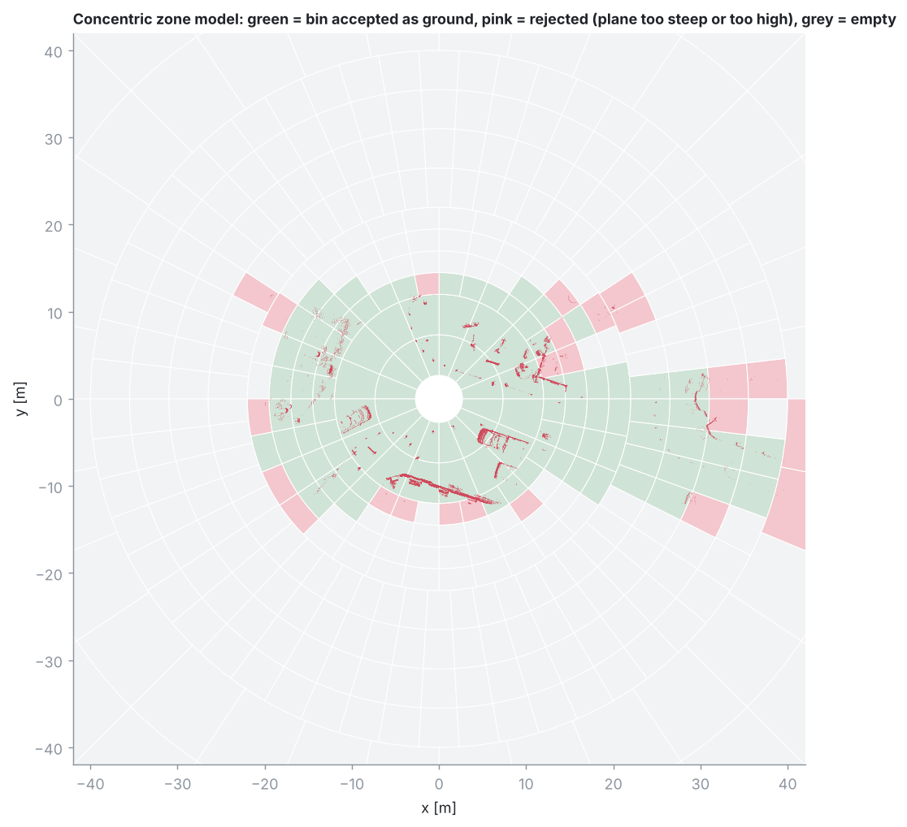

Per bin:

1. **Seeds.** Average the lowest `num_seed_points` (20) points (the *lowest
   point representative*). Points within 0.4 m above it become seeds.
2. **Fit.** Fit a plane to the seeds with total least squares. Take all points
   within 0.15 m of it (one-sided) as the new ground set, refit, and repeat
   three times.
3. **Ground likelihood checks.** Reject the bin if the normal is tilted more
   than 45° (*uprightness*). Within 22 m, a plane more than 0.7 m above the
   expected road is accepted only if it is very flat (smallest eigenvalue
   < 0.002), which lets a raised sidewalk through but not a car hood.
4. **Sparse bins** (fewer than 10 points) fall back to a height test.

**Bug found while making the figures.** An early version produced a large
false "object" in the middle of the road (visible as a big block in the range
image). The cause was 14 returns about 0.7 m *below* the road surface (a
reflection off a puddle, glass or drain cover). They were the lowest points in
their bin, so they became all of its seeds. A plane through a short arc of
points is ill-conditioned, so it tilted 17° and half the real road ended up
"above" it. Two safeguards fix it:

* **Noise floor.** Points more than 0.5 m below the expected road are labelled
  ground and never seed a plane. The `ray` and `grid` methods got the same
  rule; `grid` had the same failure mode.
* **Seed support.** A plane needs at least `num_seed_points` seeds. A smaller
  low group is skipped as an artefact.

A regression test (`BelowRoadReflectionsDoNotCorruptTheGround`) reproduces the
artefact for all four methods. It fails for `ray` and `grid` without the noise
floor; `region` passes even without the floor, thanks to the seed-support rule.

**Why region-wise is the default.** It is the only method that is locally
adaptive (it follows slopes, crowned roads and ramps) and also checks whether
a surface is plausible as road. The cost is about 9 ms, against 2–5 ms for the
others, which the budget easily allows. On flat streets like the sample data,
all four methods agree closely (61–65 k ground points). The difference shows on
slopes, where `ransac` is the first to fail.

### 4.3 Ray-based (slope walk)

After Autoware's ray ground filter. Points are sorted by range inside thin
azimuth sectors (0.4°). Walking outwards, a point is ground when two things
hold:

* its height difference to the **previous ground point** is within
  `tan(8°)·Δr` (local slope), and
* its height above the expected road is within `tan(5°)·r` (global slope).

After a gap longer than 2 m (an occlusion), the walk re-anchors to the global
model. It is cheap and handles gentle slopes, but a single noisy ray can
propagate errors.

### 4.4 Grid minimum height

Per 0.5 m cell, the lowest point is taken as the ground estimate, using the
minimum over the 3×3 neighbourhood so that a cell fully covered by a car roof
still sees the road beside it. A point is ground when it is within 0.18 m of
that minimum and the minimum itself is plausibly road height. It is the
fastest method and a good baseline, but it has no notion of slope inside a
cell.

## 5. Clustering

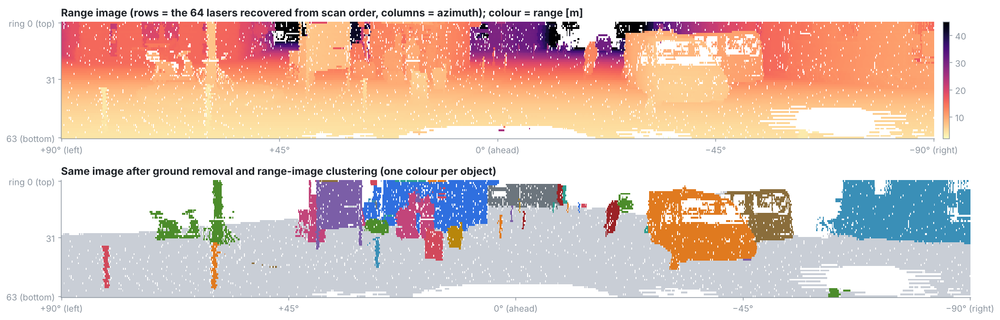

### 5.1 Range-image clustering (default)

After Bogoslavskyi & Stachniss (2016). Non-ground points are written into the
64 × 2048 range image (keeping the closest return per pixel), and connected
components are grown with a breadth-first search over the 4-neighbourhood.
Two neighbouring returns at ranges $d_1 \ge d_2$, whose beams are separated by
the angle $\alpha$, belong to the same object when

$$\beta = \operatorname{atan2}\big(d_2 \sin\alpha,\; d_1 - d_2\cos\alpha\big) > \theta, \qquad \theta = 10^\circ .$$

$\beta$ is the angle between the farther beam and the line joining the two
points. On a continuous surface it stays large; at the depth jump between two
objects (a pole in front of a wall) it collapses towards 0. The test is
implemented without `atan2`, as
$d_2\sin\alpha > \tan\theta\,(d_1 - d_2\cos\alpha)$, and $\alpha$ is the exact
angle between the two returns rather than a nominal beam spacing.

Additions to the paper's method:

* **Gap skipping.** A neighbour may be up to 3 empty columns or 2 empty rows
  away. Dropped returns and removed ground pixels would otherwise split
  objects.
* **Distance gate.** Neighbours more than 1.5 m apart are never joined.
* **Grazing-angle merge.** Surfaces seen at a grazing angle (long walls, the
  side of a bus beside us) have large depth jumps between neighbouring pixels,
  so $\beta$ cuts them into pieces even though the pieces touch in 3-D.
  Clusters that occupy a common 0.4 m voxel are joined with union-find. This
  is O(n). On frame 80 it turns the long wall on the right side of the road,
  which came out as several pieces, into one cluster (which the size filter
  then rejects as a wall).
* **Collisions.** Points hidden behind a closer return in the same pixel join
  that pixel's object if they lie within the distance gate.

### 5.2 Euclidean clustering (improved)

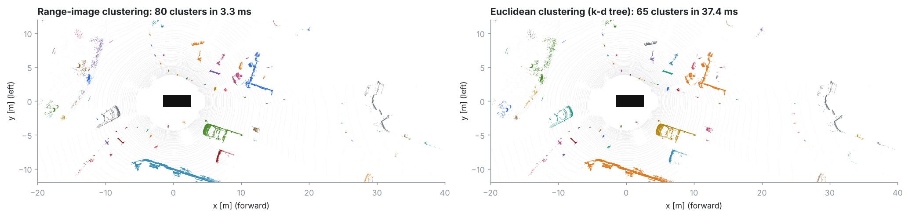

* **Balanced k-d tree** (`include/lidar_od/cluster/kdtree.h`), built by median
  splits on the axis of largest spread with `nth_element`. Its depth is
  ⌈log₂ n⌉ regardless of point order. The old tree was built by insertion in
  scan order, which degenerates on sorted input.
* **Iterative breadth-first region growing** with an explicit queue, where the
  old code recursed. A large wall could overflow the stack before.
* **Range-adaptive radius**: $r = 0.45 + 0.012\cdot\text{range}$, because
  neighbouring beams drift apart the further away an object is.
* Clusters on a 0.15 m voxel subset, then gives every original point the label
  of its nearest representative.

**Why range-image clustering is the default.** On frame 100 it takes
**3.3 ms against 37 ms**. It uses the scanner's own neighbourhood structure,
which is the right notion of adjacency for a sparse, range-dependent point
pattern, and it separates objects that are close in 3-D but at different depths.
It finds more clusters (80 against 65). Euclidean clustering joins anything
within its radius, so neighbouring objects merge: the structures left of the
road at x ≈ 10–15 m, y ≈ 2–7 m become one cluster. The range image separates
them wherever there is a depth jump. Its weakness is the opposite one, cutting
up surfaces seen at a grazing angle, which the merge pass compensates for.

## 6. Bounding boxes

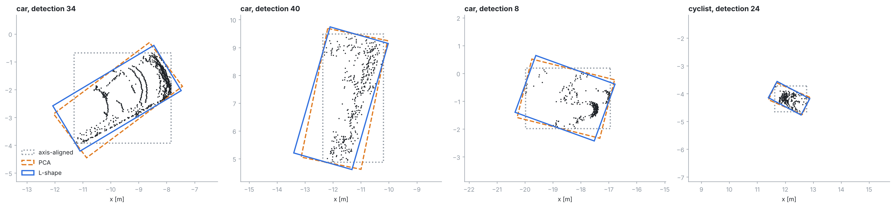

All boxes are **gravity-aligned** (yaw only). Objects on a road do not roll or
pitch, and the old free 3-D PCA box tilted with the point distribution.

* `aabb`: axis-aligned in the sensor frame, kept for reference only.
* `pca`: heading from the principal axis of the xy covariance. It is biased
  whenever only part of the object is visible. For an L-shaped view (one long
  side and the rear), the principal axis lies between the two sides. The unit
  test `PcaIsBiasedOnPartialViewsWhereLShapeIsNot` demonstrates this.
* `lshape` (default): search-based rectangle fitting after Zhang et al.
  (2017). For every candidate heading θ ∈ [0°, 90°) in 1° steps, the points
  are projected on the two rectangle axes and the heading is scored by one of
  three criteria:

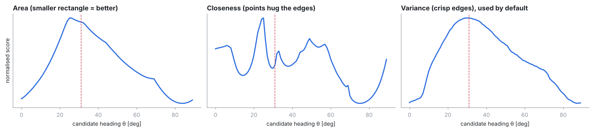

| Criterion | Score | Behaviour |
|---|---|---|
| area | −(area of the bounding rectangle) | **Ambiguous on L-shapes**: the hull of an L is a right triangle, whose minimum-area rectangle is equally small aligned with the legs or with the hypotenuse, so noise decides. Excluded from the heading unit test for this reason. |
| closeness | Σ 1 / max(distance to the nearer edge, 1 cm) | Sharp peaks, but noisy (see the middle panel) |
| variance (default) | −(variance of edge distances, per edge) | Smooth, single peak, the best behaved of the three |

The variance criterion assigns each point to its nearer edge and rewards crisp
edges. Its score curve is smooth with one clear maximum, while closeness is
jagged. That is why it is the default.

**Speed.** The search costs O(points × angles). Clusters are evenly
sub-sampled to 256 points for the heading search only; the box extent still
uses all points. This brought the box stage from 28 ms to 8 ms per frame.
Heading accuracy is guarded by the unit tests, which use clusters below the
cap, and by visual checks of the box figures.

**Ground snap.** The lowest returns of a car are often 0.2–0.4 m above the
road (bumpers, occlusion). The bottom of the box is extended down to the local
ground height (a 2 m grid built from this frame's ground points) when the gap
is under 0.4 m.

**Detection filter.** Clusters become detections only if their height is
between 0.3 m and 4 m, they are at most 12 m long and 5 m wide, and their
bottom is less than 1 m above the local ground. This rejects building walls,
vegetation canopies, signs and bridges. Rejected clusters are kept in the
output (grey below) for inspection.

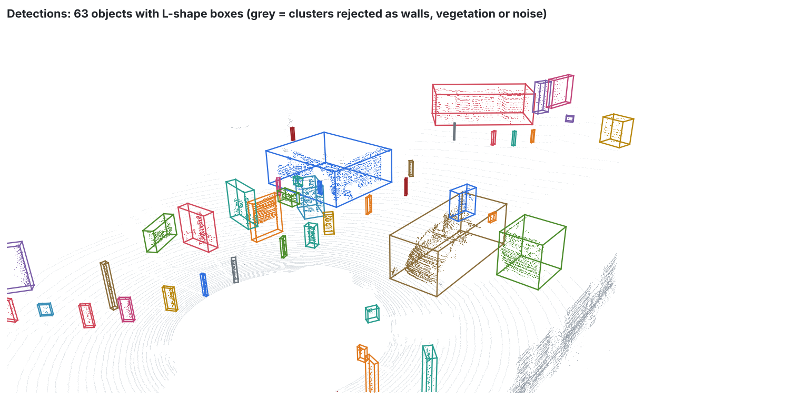

## 7. Ego-motion

Without ego-motion, tracker velocities are relative to the moving car: a
parked car appears to move at the ego speed. `EgoMotionEstimator` registers
each scan to the previous one with **NDT** (Normal Distributions Transform,
1.5 m cells), using only the points that were *not* detected as objects, so
moving objects cannot drag the estimate. The points are limited to 50 m and
voxelised to 0.5 m. The initial guess is the previous frame's motion (a
constant-velocity prior). Poses are chained into $T_{world \leftarrow sensor}$,
and detections are transformed into the world frame before tracking.

All three registration methods were run over the whole of `sequence_02`:

| Method | Distance travelled | Frame-to-frame speed jitter (std) | Static objects < 1 m/s | Mean time |
|---|---|---|---|---|
| **NDT** (default) | 71.2 m | 0.09 m/s | 81 % | 44 ms |
| GICP | 71.5 m | 0.11 m/s | 81 % | 92 ms |
| point-to-point ICP | 67.2 m | 0.61 m/s | 71 % | 68 ms |

Point-to-point ICP under-estimates the motion and jitters. Spinning-LiDAR
scans are sampled in rings, and the rings move with the car, so nearest-point
correspondences on the ground pull the estimate back towards zero motion.
NDT matches surfaces through per-cell Gaussians instead of individual points;
it agrees with GICP at half the cost.

**Check on sequence_02:** the estimated trajectory covers 71.2 m at a mean
4.65 m/s through an S-bend (black line below). Of the 202 confirmed tracks
that live at least 15 frames, 163 have a median world speed below 1 m/s.
These are the parked cars, poles and walls.

## 8. Tracking

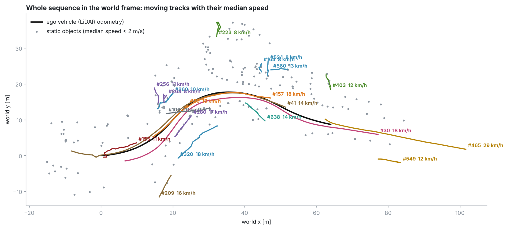

### 8.1 Motion model

Each track has a **constant-velocity Kalman filter** in the ground plane, with
state $x = [p_x, p_y, v_x, v_y]$ and measurement $z = [p_x, p_y]$ (the box
centre):

$$F = \begin{bmatrix} I & \Delta t\, I \\ 0 & I \end{bmatrix},\qquad
Q = \sigma_a^2 \begin{bmatrix} \tfrac{\Delta t^4}{4} I & \tfrac{\Delta t^3}{2} I \\ \tfrac{\Delta t^3}{2} I & \Delta t^2 I \end{bmatrix},\qquad
H = [\,I\;\;0\,],\quad R = \sigma_z^2 I$$

* $Q$ is the discretised white-noise-acceleration model, with
  $\sigma_a = 2\ \text{m/s}^2$ (urban manoeuvres) and $\sigma_z = 0.25$ m.
* The covariance update uses the **Joseph form** to stay symmetric positive
  definite.
* Δt comes from frame timestamps (an optional `timestamps.txt`, otherwise
  0.1 s).

Box size, yaw and height are smoothed outside the filter. The yaw update
respects that a box heading is only defined modulo 180°.

### 8.2 Data association

1. **Gating.** A detection can match a track only if its squared Mahalanobis
   distance $y^\top S^{-1} y$ is below 9.21 (the 99 % point of χ² with 2 degrees of
   freedom) and it is within 3 m.
2. **Cost** = negative log-likelihood, $y^\top S^{-1} y + \ln|S|$.
3. **Matching cascade.** Confirmed tracks are assigned first; tentative tracks
   only compete for leftover detections.
4. Each stage is solved **optimally with the Hungarian algorithm**
   (Kuhn–Munkres with potentials, any matrix shape;
   `src/tracking/hungarian.cpp`). It is tested against brute force on random
   matrices.

Steps 2 and 3 fix a real identity switch found on the sample data. In frame
34, an 8-point fragment next to the cyclist spawned a tentative track. The
next frame, plain Mahalanobis cost gave that track the cyclist's detection:
a fresh track's large covariance makes any detection look close. From then on
the new track followed the cyclist, while the established track picked up
small fragments, coasted, and was deleted at frame 45. With the cascade and the
$\ln|S|$ term, the cyclist keeps one identity (#30) for the whole sequence.

### 8.3 Track life cycle

`tentative` → `confirmed` after 3 hits. A tentative track is deleted after
1 miss; a confirmed track coasts on its prediction for up to 5 missed frames,
then is deleted.

| Object | Track | Frames | Coasting frames | Median speed | Median size (L × W × H) |
|---|---|---|---|---|---|
| Cyclist ahead | #30 | 2–153 (152, all) | 0 | 4.87 m/s (17.5 km/h) | 1.41 × 0.61 × 1.64 m |
| Car following behind | #41 | 2–153 (152, all) | 0 | 4.01 m/s (14.4 km/h) | 3.88 × 1.90 × 1.38 m |


## 9. Runtime

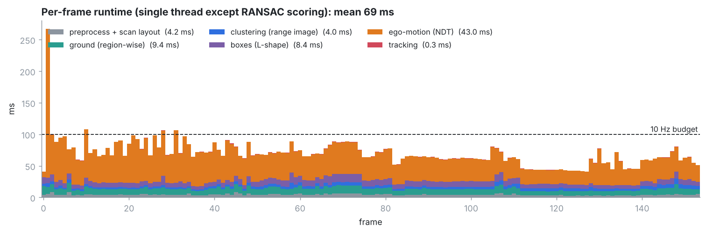

Measured over all 154 frames of `sequence_02` on one core of a 2.1 GHz Xeon
(RANSAC scoring is OpenMP-parallel but not the default):

| Stage | Mean | p95 |
|---|---|---|
| Preprocess + scan layout | 4.2 ms | 6.1 ms |
| Ground (region-wise) | 9.4 ms | 12.8 ms |
| Clustering (range image) | 4.0 ms | 6.1 ms |
| Boxes (L-shape) | 8.4 ms | 13.1 ms |
| Ego-motion (NDT) | 43.0 ms | 70.4 ms |
| Tracking | 0.3 ms | 0.5 ms |
| **Total** | **69.3 ms** | **96.9 ms** |

Detection alone (everything except ego-motion) takes about 26 ms per frame.
NDT dominates. Four of 154 frames exceed the 100 ms budget of a 10 Hz sensor;
the slowest (267 ms) is the very first registration, which has no motion prior.
Cheap options if real-time headroom is needed: register every other frame,
use a coarser voxel grid, or switch `ego_motion.method` to `none` when the
vehicle provides odometry.

## 10. Testing and validation

There is no labelled ground truth for the bundled sequences, so validation
works on three levels:

1. **Unit tests with known ground truth** (`tests/`, 30 tests, run in CI). A
   ray-cast 64-beam scanner over synthetic scenes (`tests/synthetic.h`) checks:
   * ground and object recall for all four ground methods, and the
     below-road reflection regression;
   * cluster purity for both clusterers, depth-jump separation, and ring
     recovery with its fallback;
   * k-d tree radius search against brute force;
   * L-shape heading and size within 2.5° and 15 cm on partial views, the PCA
     bias, and ground snapping;
   * Hungarian assignment against brute force; Kalman convergence within its
     own 3σ bound with a positive-definite covariance;
   * the tracker keeping two identities through a crossing with a 2-frame
     occlusion;
   * config parsing, including rejection of typos.
2. **Consistency checks on real data.** Static objects read about 0 m/s in the
   world frame, the ego trajectory is smooth and plausible, and long-lived
   objects keep one identity.
3. **Visual inspection** of every stage (the figures in this document). This
   is how the reflection bug and the identity switch were found.

## 11. Limitations and next steps

* **No quantitative benchmark yet.** With a labelled dataset (e.g. KITTI
  Tracking), the headless runner's CSV output can be scored for detection
  precision and recall per distance band, and for MOTA or HOTA.
* **No classification.** Objects are class-agnostic. The natural next step is
  a classical classifier (random forest or SVM) on hand-crafted cluster
  features: dimensions, point density normalised by range, eigenvalue shape
  features (linearity, planarity, scattering), intensity statistics, and track
  speed. Smoothing the class by voting over each track's history would follow.
* **Spurious motion of vegetation.** Bushes and trees change shape between
  scans, so their box centres jitter. A handful get short "moving" tracks at
  8–13 km/h (visible off the road in the world-frame figure). A classifier, or
  a check on how consistent the velocity is over the track's history, would
  remove them.
* **Motion model.** Constant velocity is adequate at 10 Hz for city speeds. A
  CTRV model with an unscented Kalman filter, or an IMM mixing CV and CTRV,
  would track turning vehicles more tightly.
* **Over-segmentation of touching objects** by the range image (a pedestrian
  leaning on a car). The merge pass trades this off against wall
  fragmentation; its voxel size is the knob.
* **Box centre vs object centre.** For partially seen objects the box covers
  only the visible extent. Its centre therefore shifts as more of the object
  becomes visible, which the Kalman filter partly absorbs as velocity noise.
  Tracking the visible corner nearest the sensor is a common refinement.

## 12. Reproducing the figures

```bash
cmake -S . -B build && cmake --build build -j
./build/lidar_od_stages --frame 100 --out output/stages_100   # every algorithm on one frame
./build/lidar_od_run --out output/run                          # whole sequence: tracks, poses, timing
python3 scripts/render_figures.py --stages output/stages_100 --run output/run \
    --data data/sequence_02 --out docs/images
xvfb-run -a ./build/lidar_od_viewer --screenshot docs/images/00_viewer_3d.png --frame 100 --size 1600x800
```

## 13. References

* I. Bogoslavskyi, C. Stachniss. *Fast Range Image-Based Segmentation of
  Sparse 3D Laser Scans for Online Operation.* IROS 2016.
* H. Lim, M. Oh, H. Myung. *Patchwork: Concentric Zone-based Region-wise Ground
  Segmentation with Ground Likelihood Estimation Using a 3D LiDAR Sensor.*
  RA-L 2021. (Patchwork++: S. Lee et al., IROS 2022.)
* X. Zhang, W. Xu, C. Dong, J. M. Dolan. *Efficient L-Shape Fitting for Vehicle
  Detection Using Laser Scanners.* IEEE IV 2017.
* M. A. Fischler, R. C. Bolles. *Random Sample Consensus.* Comm. ACM 1981.
* P. Biber, W. Straßer. *The Normal Distributions Transform: A New Approach to
  Laser Scan Matching.* IROS 2003. M. Magnusson, *The Three-Dimensional
  Normal-Distributions Transform*, PhD thesis, Örebro University, 2009.
* H. W. Kuhn. *The Hungarian Method for the Assignment Problem.* Naval Research
  Logistics Quarterly 1955.
* N. Wojke, A. Bewley, D. Paulus. *Simple Online and Realtime Tracking with a
  Deep Association Metric* (DeepSORT, origin of the matching cascade). ICIP
  2017.
* Y. Bar-Shalom, X. R. Li, T. Kirubarajan. *Estimation with Applications to
  Tracking and Navigation.* Wiley 2001.
* A. Geiger, P. Lenz, C. Stiller, R. Urtasun. *Vision meets Robotics: The KITTI
  Dataset.* IJRR 2013.
